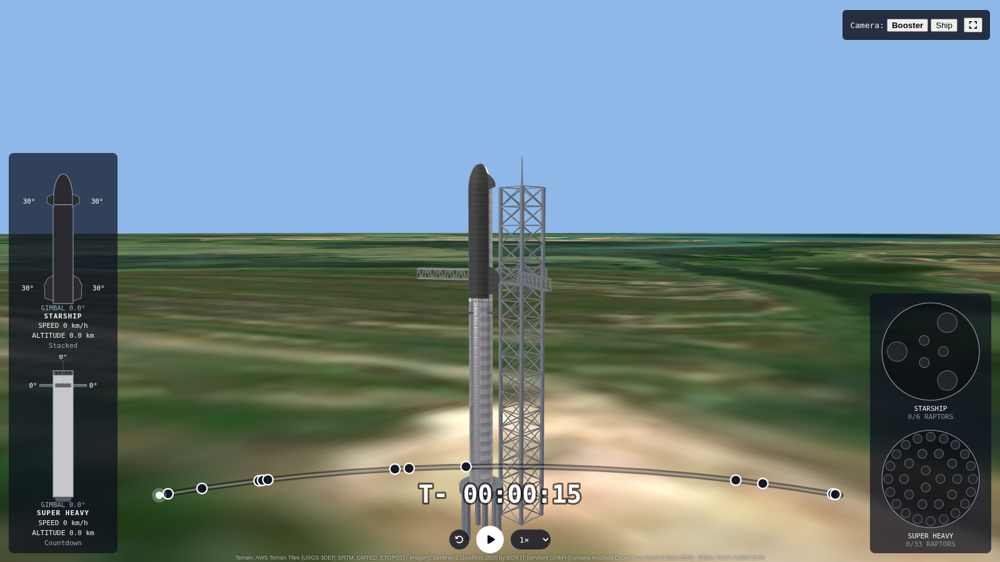

# Starship Flight Simulator

A 3D browser simulation of a full Starship test flight, from liftoff and hot
staging through the booster's tower catch to the ship's reentry and splashdown
in the Indian Ocean.

## Features
- Full flight timeline (T-15 s to splashdown) with milestones: Max Q, MECO, hot staging, boostback, catch, SECO, entry
- Booster catch by the launch tower's chopsticks
- Engine gimbal overlay and vehicle diagrams
- 3D globe using real elevation and satellite imagery

## Running locally
npm install
npm run dev

Built with React, Three.js, TypeScript and Vite.

## About the data
The flight profile is based on publicly reported milestones from Starship
test flights (Flight 5 onward). Second-by-second telemetry isn't published,
so values between milestones are smooth estimates.

## Credits
- Earth texture: NASA Blue Marble
- Satellite imagery: Sentinel-2 cloudless 2020 by EOX (CC BY-NC-SA 4.0)
- Elevation: Terrarium tiles (Mapzen / AWS Open Data)

## Disclaimer
Unofficial fan project, not affiliated with or endorsed by SpaceX.

## About me
I'm Jesse Bautista, a software engineer open to remote work and graphics
projects. [LinkedIn](https://www.linkedin.com/in/jesse-r-bautista/)
